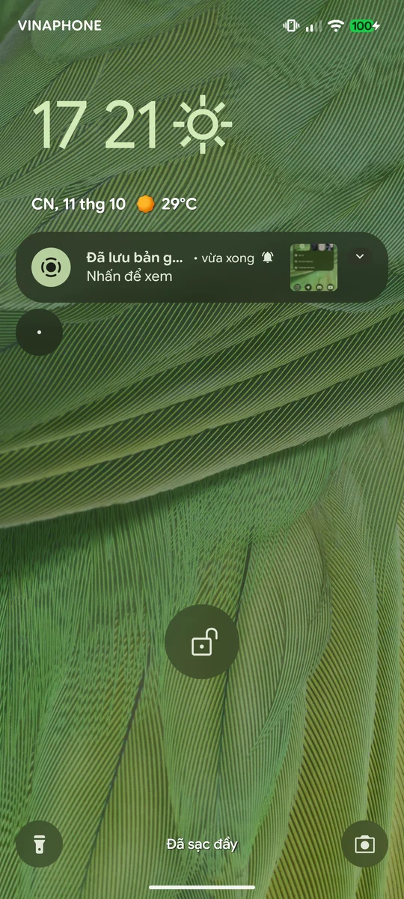
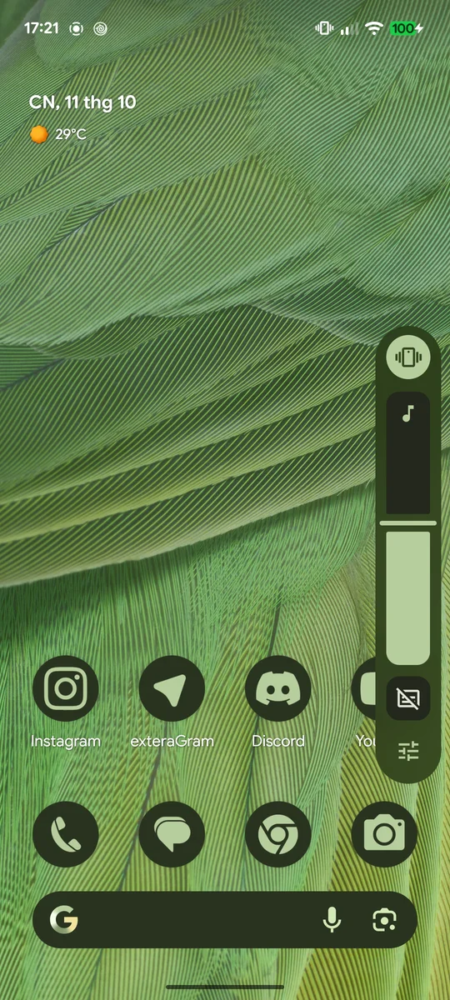
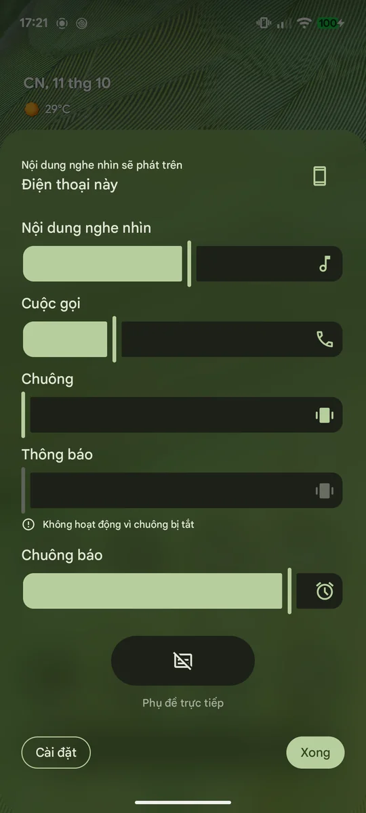
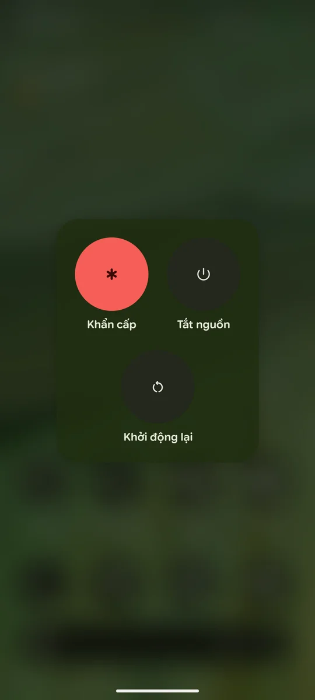
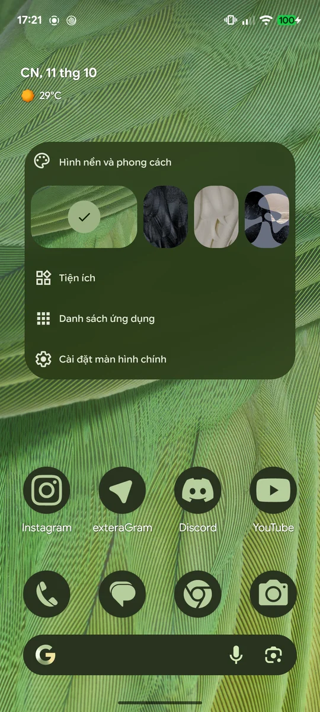
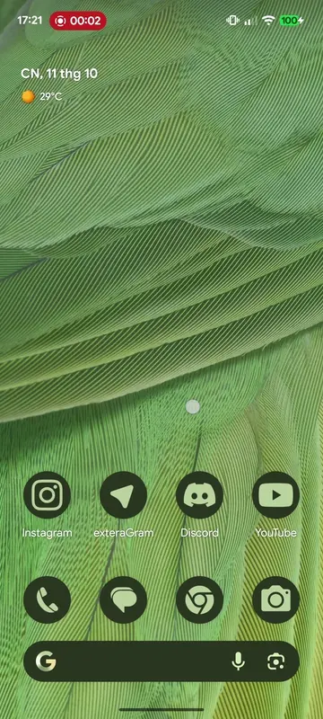
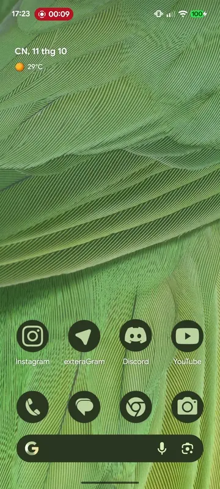

# Blur Enabler

An Xposed module that brings back the blur effects Google turns off on some
Pixels (Tensor G2 and others). It re-implements the AOSP code paths that the
stock builds disable or strip, so the result matches what upstream SystemUI
and Launcher3 do with those features enabled.

Tested on a Pixel 7 (`panther`) running stock Android 17
(`CP3A.261005.002.A1`) with Vector (LSPosed) on ReZygisk and KernelSU-Next.

## Preview

<table>
  <tr>
    <td align="center"></td>
    <td align="center"></td>
    <td align="center"></td>
  </tr>
  <tr>
    <td align="center"><b>Lockscreen</b></td>
    <td align="center"><b>Volume dialog</b></td>
    <td align="center"><b>Volume panel</b></td>
  </tr>
  <tr>
    <td align="center"></td>
    <td align="center"></td>
    <td align="center"></td>
  </tr>
  <tr>
    <td align="center"><b>Power menu</b></td>
    <td align="center"><b>Launcher menu</b></td>
    <td align="center"><b>Launcher menu (animated)</b></td>
  </tr>
  <tr>
    <td align="center" colspan="3"><br><b>App launch and swipe-to-home blur</b></td>
  </tr>
</table>

## What it enables

| Feature | Gate on stock | What the module does |
| --- | --- | --- |
| Volume dialog, power menu, launcher folders / all apps / menus | `config_enableBlurExpansion` set to `false` by the device's vendor overlay | Forces the framework bool to `true` in SystemUI and Pixel Launcher |
| App launch blur | `config_enableAppLaunchBlur` set to `false` by the vendor overlay | Forces the framework bool to `true` in Pixel Launcher |
| Swipe-to-home blur | `com.android.launcher3.blurred_home_animation` (read-only false, code stripped) | Restores `ScalingWorkspaceRevealAnim.addBlurLayer()` |
| Lockscreen lock icon and shortcuts | `com.android.systemui.enable_lockscreen_blur` (read-only false, code stripped) | Restores the blur and `surfaceEffect1` tint behind the device entry icon and the Compose lockscreen shortcuts, plus the shortcuts' fade in and out |
| Lockscreen notifications and the notification shelf | `com.android.systemui.lockscreen_blur_for_notifications` (read-only false, code stripped) | Makes rows translucent on the lockscreen and restores `NotificationBackgroundView`'s blur, including the alpha propagation stock removed |
| Power menu blur under the navigation bar | Not a flag: the dialog window stops at the navigation bar inset | Extends the power menu window under the navigation bar so its blur covers the whole screen |

Read-only aconfig flags are compiled into SystemUI and Launcher3 as
constants, so R8 removes the code behind them; no flag override, overlay or
property can turn them back on. Each hook mirrors the upstream code it
replaces and is commented with what stock left behind.

## Requirements

- A rooted Pixel on a stock build with Pixel Launcher.
- An LSPosed-compatible framework (LSPosed, Vector, ...).
- A compositor that supports cross-window blur
  (`ro.surface_flinger.supports_background_blur=1`), with
  **Developer options > Allow window-level blurs** left on.

## Install

1. Install `BlurEnabler.apk` from the releases page.
2. Enable **Blur Enabler** in your LSPosed manager with the scopes
   `com.android.systemui` and `com.google.android.apps.nexuslauncher`.
3. Reboot, or restart SystemUI and Pixel Launcher.

The module logs `BlurEnabler: ... hooks installed` lines to the framework log
for every part it sets up, and the cause when a part is unavailable.

## Differences from upstream

These are deliberate and commented in the source:

- **Power menu:** the window extends under the navigation bar so the blur
  isn't cut off there. The menu keeps its stock position.
- **Lock icon blur:** the blur radius reuses `keyguard_shortcuts_blur_radius`,
  because stock dropped `fingerprint_icon_blur_radius`. Its alpha also follows
  the parent view and the lockscreen fade, since stock's scene container fades
  the lockscreen through a Compose layer that blur regions don't inherit.
- **Notification blur:** the blur region is clipped to the row's visible
  area (blur regions ignore view and canvas clipping). Without this, rows
  folded into the lockscreen shelf keep blurring at full size.
- **Shortcuts:** no blur behind a selected shortcut (only seen in the
  shortcut picker preview).

## Known limitations

- The lockscreen fade signal comes from the shortcuts' `transitionAlpha`. If
  both lockscreen shortcuts are disabled, the lock icon and notification blur
  won't fade out on unlock.
- Hooks target the class and field names of the tested build. A new Android
  QPR or Pixel Launcher update can rename or remove them; check the framework
  log after updating.
- Blur costs GPU time. Lockscreen and shade notifications each get their own
  blur region, as upstream does with these flags on.

## Building

Requires a JDK, the Android SDK (`build-tools/37.0.0`, `platforms/android-36.1`)
and `zip`:

```sh
./build.sh
```

The Xposed API 82 jar is downloaded to `libs/` as a compile-only dependency.
The APK is signed with `~/.android/debug.keystore` unless `KEYSTORE` points
elsewhere, and written to `out/BlurEnabler.apk`.

## License

Apache License 2.0. The hooks re-implement code from the Android Open Source
Project, which is also Apache 2.0.
